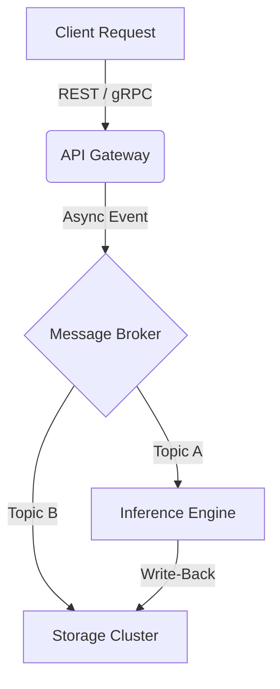

# Welcome to My Technical Blog 🚀

I am a **CSD (B.Tech + MS by Research) student at IIIT Hyderabad**, specializing in computing systems and engineering trade-offs. This space serves as a living repository for my technical whitepapers, deep architectural dives, and research deconstructions.

---

## 🔬 Sample Research Deep Dive: Low-Latency Systems

When designing distributed systems, evaluating the trade-offs between consistency and availability is critical. Below is a mathematical formulation often used to model network constraints, followed by a typical multi-tier architecture layout.

### 1. Theoretical Modeling (Math Check)
If your blog theme supports MathJax/KaTeX, the following equation will render as a crisp mathematical formula:

$$ \lim_{n \to \infty} P(\text{Latency} > \delta) = e^{-\lambda \delta} $$

Where $\lambda$ represents the system throughput capacity, and $\delta$ represents our strict SLA deadline.

### 2. System Architecture Blueprint
This diagram maps out a standard decoupled microservices pipeline. If your theme supports **Mermaid.js**, it will render as a clean visual flowchart automatically:



### 3. Core Implementation (Rust Code Snippet)
Here is a fast, safe snippet showing how we handle async thread pooling inside our high-throughput ingest layer:

```rust
use tokio::sync::mpsc;

#[tokio::main]
async fn main() {
    // Create a bounded channel for incoming system events
    let (tx, mut rx) = mpsc::channel(100);

    tokio::spawn(async move {
        tx.send("System Event Logged").await.unwrap();
    });

    while let Some(message) = rx.recv().await {
        println!("Received: {}", message);
    }
}
```

---

## 📚 Ongoing Whitepapers
*   **[WP-001]** Optimizing Matrix Multiplication Kernels on Edge Accelerators *(Coming Soon)*
*   **[WP-002]** A Critical Review of Raft vs. Paxos in High-Throughput DB Internals *(Coming Soon)*

---
[View my GitHub Profile](https://github.com) | [Contact via Email](mailto:your.email@research.iiit.ac.in)
